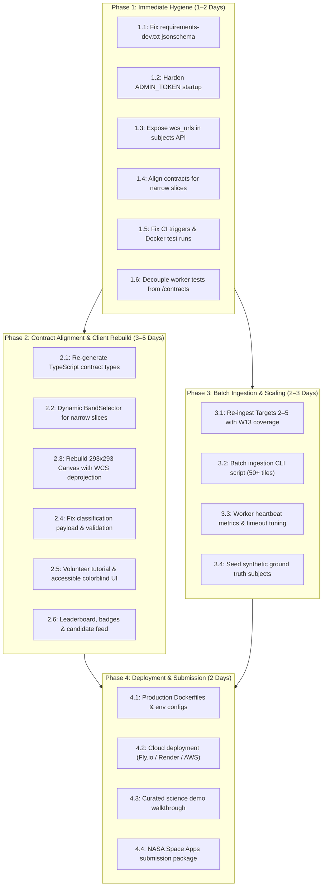

# AstroBlink — Prioritized Next Steps & Backlog

**Purpose:** Actionable, prioritized engineering backlog of remaining work required to take AstroBlink from its post-audit state (`cc39991`) to hackathon demonstration and production readiness.  
**Last-Verified Date:** `2026-10-13`  
**Audited Commit:** `cc39991`  

---

## 1. Backlog Overview & Roadmap Phasing

AstroBlink's ingestion pipeline (`worker/`) and consensus backend (`api/`) are merged and de-risked against live NASA SPHEREx Level 2 FITS archives [VERIFIED: `audit/03_component_audit.md`]. However, the frontend (`client/`) is an obsolete scaffold using retired wavelength band models, the OpenAPI contracts diverge from the narrow-slice reality, and production security gates are unconfigured [VERIFIED: `audit/05_known_issues.md`].

The remaining engineering work is partitioned into four sequential phases:

---

## 2. Phase 1: Immediate Hygiene (1–2 Days)

Critical fixes to eliminate contract drift, prevent test failures, and secure API administrative endpoints.

### Item 1.1: Add `jsonschema` to `api/requirements-dev.txt` [VERIFIED: ISS-05]
- **Owner Role:** Role 2 (Backend & Consensus Dev)
- **Effort:** 0.5 hours
- **Dependencies:** None
- **Files to Touch:**
  - `api/requirements-dev.txt`
- **Acceptance Criteria:**
  - `jsonschema>=4.20.0` is added to `api/requirements-dev.txt`.
  - Rebuilding the `api` test container and running `pytest tests/test_contract_validation.py` succeeds without `--ignore` flags.
  - Full suite runs: `pytest` passes 33/33 tests inside the container.

### Item 1.2: Enforce Production Gate on `ADMIN_TOKEN` [VERIFIED: ISS-01]
- **Owner Role:** Role 2 (Backend & Consensus Dev) / Role 5 (DevOps & Cloud Engineer)
- **Effort:** 1 hour
- **Dependencies:** None
- **Files to Touch:**
  - `api/app/config.py`
  - `api/app/main.py`
  - `api/tests/test_auth.py`
- **Acceptance Criteria:**
  - `api/app/config.py` or lifespan in `main.py` raises `RuntimeError` or `ValueError` on startup if `ENVIRONMENT == "production"` and `ADMIN_TOKEN == "dev-admin-token-change-in-production"`.
  - New test in `api/tests/test_auth.py` asserts server fails startup when production environment variable is active with default token.
  - Server boots normally in `development` or `test` mode with a warning log.

### Item 1.3: Expose `wcs_urls` in Subject Endpoint [VERIFIED: ISS-03]
- **Owner Role:** Role 2 (Backend & Consensus Dev)
- **Effort:** 2 hours
- **Dependencies:** None
- **Files to Touch:**
  - `api/app/models/subject.py` (add `wcs_urls` JSONB column or synthesize from `tile_urls`)
  - `api/alembic/versions/002_add_wcs_urls.py` (migration if column added)
  - `api/app/routers/subjects.py` (populate `wcs_urls` dictionary in response)
  - `api/tests/test_subjects.py` (assert `wcs_urls` contains `.wcs.json` links matching tile keys)
- **Acceptance Criteria:**
  - `GET /api/v1/subjects/{subject_id}` and `GET /api/v1/subjects/next` return `wcs_urls` containing presigned/public URLs for all generated bands (e.g. `{"1_1.0um": "http://.../1_1.0um.wcs.json", ...}`).
  - Response matches `contracts/openapi.yaml` and schema validation passes.

### Item 1.4: Update OpenAPI Contracts and Schemas for Narrow Slices [VERIFIED: ISS-04]
- **Owner Role:** Role 6 (Full-Stack Integrator & Team Lead)
- **Effort:** 2 hours
- **Dependencies:** None
- **Files to Touch:**
  - `contracts/openapi.yaml`
  - `contracts/schemas/subject.yaml`
  - `contracts/schemas/wcs_sidecar.yaml`
- **Acceptance Criteria:**
  - Pattern for `tile_urls` keys in `subject.yaml` allows `^[12]_(1\.0um|2\.0um|4\.0um|rgb)$` (or general `^[12]_[a-zA-Z0-9._]+$`).
  - `wcs_sidecar.yaml` allows worker metadata fields (`target_id`, `epoch`, `band_slice`, `original_exposure_ids`, `effective_wavelength_um`, `flags_masked`) by either adding them to `properties` or setting `additionalProperties: true`.
  - `api/tests/test_contract_validation.py` passes against live worker output.

### Item 1.5: Fix CI Trigger Filters and Add Containerized Test Runs [VERIFIED: ISS-14]
- **Owner Role:** Role 5 (DevOps & Cloud Engineer)
- **Effort:** 3 hours
- **Dependencies:** None
- **Files to Touch:**
  - `.github/workflows/ci-api.yml`
  - `.github/workflows/ci-worker.yml`
  - `.github/workflows/ci-client.yml`
- **Acceptance Criteria:**
  - Workflow path triggers include `contracts/**` and `infra/**` in addition to app directories.
  - Workflows build Docker images and execute pytest/npm inside container environments to ensure parity with local Docker runs.

### Item 1.6: Decouple Worker Schema Tests from Host Mounts [VERIFIED: ISS-07]
- **Owner Role:** Role 1 (Astronomy Data Engineer) / Role 5 (DevOps & Cloud Engineer)
- **Effort:** 2 hours
- **Dependencies:** Item 1.4
- **Files to Touch:**
  - `worker/tests/test_ingest_job_schema.py`
  - `worker/Dockerfile`
- **Acceptance Criteria:**
  - Test resolves schema path gracefully using environment variable `CONTRACTS_DIR` with fallback: `/contracts` -> `../../contracts` -> skipped with clear warning if neither exists.
  - `docker build -f worker/Dockerfile worker/` followed by container execution passes tests without requiring host bind mounts.

---

## 3. Phase 2: Contract Alignment & Client Rebuild (3–5 Days)

The client application must be brought from a mock scaffold to a fully functional, science-grade citizen science blink comparator.

### Item 2.1: Re-generate TypeScript API Client [REPORTED]
- **Owner Role:** Role 3 (Frontend Canvas Dev) / Role 6 (Team Lead)
- **Effort:** 2 hours
- **Dependencies:** Item 1.4
- **Files to Touch:**
  - `client/src/types/api.ts` (or `client/src/lib/api-client.ts`)
  - `client/package.json` (add openapi-typescript code generator script)
- **Acceptance Criteria:**
  - Automated script `npm run codegen:contracts` generates TypeScript interfaces directly from `contracts/openapi.yaml`.
  - Types for `Subject`, `ClassificationCreate`, `Mark`, and `Candidate` match backend schemas.

### Item 2.2: Dynamic Band Selector for Narrow Slices [VERIFIED: ISS-02]
- **Owner Role:** Role 3 (Frontend Canvas Dev)
- **Effort:** 4 hours
- **Dependencies:** Item 2.1
- **Files to Touch:**
  - `client/src/components/BandSelector.tsx`
  - `client/src/app/classify/page.tsx`
- **Acceptance Criteria:**
  - Band selector inspects keys present in `subject.tile_urls` dynamically.
  - Available tabs render: `1.0 μm (SWIR)`, `2.0 μm (MWIR-1)`, `4.0 μm (MWIR-2)`, `RGB Composite`.
  - Band switching immediately switches displayed image in the active viewport without resetting blink cadence.
  - Missing bands for a given subject display clear disabled state.

### Item 2.3: Rebuild $293 \times 293$ Canvas with WCS Deprojection [VERIFIED: ISS-02]
- **Owner Role:** Role 3 (Frontend Canvas Dev)
- **Effort:** 8 hours
- **Dependencies:** Item 1.3, Item 2.2
- **Files to Touch:**
  - `client/src/components/BlinkComparator.tsx` (new component)
  - `client/src/lib/wcs.ts` (new client-side tangent projection utility)
  - `client/src/app/classify/page.tsx`
- **Acceptance Criteria:**
  - Canvas scales native $293 \times 293\text{ pixel}$ tiles crisply with nearest-neighbor or bilinear interpolation.
  - Toggle between Epoch 1 and Epoch 2 runs on selectable timer (0.25s, 0.5s, 1.0s, manual flip).
  - Clicking on a candidate fetches corresponding `.wcs.json` sidecar for the tile.
  - Coordinate conversion calculates $(\alpha, \delta)$ via TAN projection:
    $$\begin{pmatrix} x' \\ y' \end{pmatrix} = \begin{pmatrix} \text{CD1\_1} & \text{CD1\_2} \\ \text{CD2\_1} & \text{CD2\_2} \end{pmatrix} \begin{pmatrix} x - x_0 \\ y - y_0 \end{pmatrix}$$
  - Marking an object displays crosshairs and labels in both Epoch 1 and Epoch 2 viewports.

### Item 2.4: Classification Submit Payload Contract Compliance [VERIFIED: ISS-12]
- **Owner Role:** Role 3 (Frontend Canvas Dev)
- **Effort:** 3 hours
- **Dependencies:** Item 2.1, Item 2.3
- **Files to Touch:**
  - `client/src/app/classify/page.tsx`
  - `client/src/lib/api.ts`
- **Acceptance Criteria:**
  - `POST /api/v1/classify` payload strictly satisfies `ClassificationCreate` schema:
    - `subject_id`: UUID string.
    - `user_id`: Session UUID string.
    - `marks`: Array of `Mark` objects with `ra`, `dec`, `epoch` (1 or 2), `band`, `category` ("dipole", "mover", "transient", "variable").
    - `metadata`: Client viewing time, blink toggles count, zoom level.
  - Successful response updates client user stats and advances to next subject via `prefetch`.

### Item 2.5: Volunteer Onboarding Tutorial & Accessible Visual Legend [REPORTED]
- **Owner Role:** Role 4 (UI/UX & Gamification Lead)
- **Effort:** 6 hours
- **Dependencies:** Item 2.3
- **Files to Touch:**
  - `client/src/components/TutorialModal.tsx`
  - `client/src/components/LegendHatching.tsx`
  - `client/src/app/classify/page.tsx`
- **Acceptance Criteria:**
  - First-time users are presented with a 4-step modal explaining:
    1. What SPHEREx sees (infrared sky, matched narrow slices).
    2. What a dipole looks like (black/white adjacent PSF artifacts from movement).
    3. What an outer solar system body looks like ($63\text{--}136\text{ px}$ shift over 6 months).
    4. What a brown dwarf looks like (stationary, extreme $4.0\text{ }\mu\text{m}$ brightness).
  - High-contrast visual mode with colorblind-friendly hatching for masks and flags.

### Item 2.6: Leaderboard, Badges & Candidate Discovery Feed [REPORTED]
- **Owner Role:** Role 4 (UI/UX & Gamification Lead)
- **Effort:** 5 hours
- **Dependencies:** Item 2.4
- **Files to Touch:**
  - `client/src/app/leaderboard/page.tsx`
  - `client/src/app/candidates/page.tsx`
  - `client/src/components/UserStats.tsx`
- **Acceptance Criteria:**
  - Leaderboard displays top volunteers ranked by valid classification count and reliability score.
  - Candidate feed displays consensus candidates (`min_score >= 0.7`) with thumbnail cutouts, sky coordinates, and VOTable/CSV download links.

---

## 4. Phase 3: Batch Ingestion & Scaling (2–3 Days)

Expand data volume from 1 verified test target to a robust catalog of astronomical sky cells.

### Item 3.1: Re-ingest Targets 2–5 with W13 Coverage Fix [VERIFIED: ISS-06]
- **Owner Role:** Role 1 (Astronomy Data Engineer)
- **Effort:** 4 hours
- **Dependencies:** Stable high-bandwidth internet connection to AWS S3
- **Files to Touch:**
  - `infra/scripts/reingest_targets.py` (new orchestration script)
- **Acceptance Criteria:**
  - Re-run ingestion jobs for Target 2 (High proper motion brown dwarf), Target 3 (Ecliptic calibration field), Target 4 (CVZ field), Target 5 (Planet X candidate field).
  - Verify every target produces valid $293 \times 293$ tiles across all three slices ($1.0, 2.0, 4.0\text{ }\mu\text{m}$).
  - Confirm database contains at least 5 complete subjects with valid `tile_urls` and `wcs_urls`.

### Item 3.2: Batch Ingestion CLI Script [REPORTED]
- **Owner Role:** Role 1 (Astronomy Data Engineer) / Role 5 (DevOps & Cloud Engineer)
- **Effort:** 4 hours
- **Dependencies:** Item 3.1
- **Files to Touch:**
  - `worker/worker/batch_ingest.py` (new CLI script)
  - `worker/Dockerfile`
- **Acceptance Criteria:**
  - CLI script accepts a list of sky coordinates or a target catalog CSV.
  - Queries IRSA TAP to verify dual-epoch coverage before enqueuing.
  - Enqueues jobs to Redis `astroblink:ingest_jobs` with configurable concurrency and rate limiting.
  - Emits real-time progress bar and log summary of enqueued vs completed jobs.

### Item 3.3: Worker Heartbeat Telemetry & Ingestion Timeout Tuning [VERIFIED: ISS-09, ISS-10]
- **Owner Role:** Role 1 (Astronomy Data Engineer)
- **Effort:** 3 hours
- **Dependencies:** None
- **Files to Touch:**
  - `worker/worker/config.py`
  - `worker/worker/main.py`
- **Acceptance Criteria:**
  - Increase default `job_timeout_sec` from 600 to 1200 seconds in `config.py` with dynamic timeout based on number of input FITS exposures.
  - Heartbeat logger writes structured JSON to `/tmp/worker_heartbeat.json` containing: `last_heartbeat_utc`, `active_job_id`, `download_bytes_sec`, `memory_rss_mb`.
  - Health check endpoint or Docker healthcheck reads heartbeat JSON and fails container only if heartbeat is stale > 120 seconds.

### Item 3.4: Seed Synthetic Ground Truth Subjects for Voter Calibration [VERIFIED: ISS-13]
- **Owner Role:** Role 1 (Astronomy Data Engineer) / Role 2 (Backend & Consensus Dev)
- **Effort:** 6 hours
- **Dependencies:** Item 3.1
- **Files to Touch:**
  - `worker/worker/synthetic.py` (synthetic source injection module)
  - `api/scripts/seed_ground_truth.py`
- **Acceptance Criteria:**
  - Pipeline can inject synthetic mover PSFs (60–140 pixel shift) into 5% of tiles.
  - Mark coordinates of synthetic sources are recorded in database as `ground_truth=true`.
  - Consensus algorithm evaluates volunteer classifications against synthetic ground truth to dynamically calibrate reliability weights $w_v$.

---

## 5. Phase 4: Deployment & Submission (2 Days)

Packaged, documented, and published deployment for the hackathon judging panel.

### Item 4.1: Production Dockerfiles & Multi-Stage Builds [REPORTED]
- **Owner Role:** Role 5 (DevOps & Cloud Engineer)
- **Effort:** 4 hours
- **Dependencies:** Item 1.1, Item 1.2
- **Files to Touch:**
  - `api/Dockerfile`
  - `client/Dockerfile`
  - `worker/Dockerfile`
  - `infra/docker-compose.prod.yml`
- **Acceptance Criteria:**
  - `api` Dockerfile uses multi-stage build, non-root user `astroblink`, and runs Gunicorn with Uvicorn workers.
  - `client` Dockerfile outputs standalone Next.js server with minimal production footprint.
  - Container vulnerability scan passes with 0 critical or high CVEs.

### Item 4.2: Cloud Deployment (Fly.io / Render / AWS) [REPORTED]
- **Owner Role:** Role 5 (DevOps & Cloud Engineer)
- **Effort:** 6 hours
- **Dependencies:** Item 4.1
- **Files to Touch:**
  - `infra/deploy/fly.toml` (or `render.yaml`)
  - `infra/deploy/README.md`
- **Acceptance Criteria:**
  - PostgreSQL database provisioned (with pgSphere extension or standard geometry fallback).
  - Redis instance deployed.
  - AWS S3 or Cloudflare R2 bucket provisioned for public tile hosting.
  - Web client live at public URL with HTTPS and valid CORS configuration.

### Item 4.3: Curated Science Demo Walkthrough [REPORTED]
- **Owner Role:** Role 6 (Team Lead) / Role 4 (UI/UX Lead)
- **Effort:** 4 hours
- **Dependencies:** Item 3.1, Item 4.2
- **Files to Touch:**
  - `docs/DEMO_WALKTHROUGH.md`
  - `client/src/data/featured_subjects.json`
- **Acceptance Criteria:**
  - 3 curated subjects highlighted on landing page:
    1. High-parallax outer solar system simulation (clear $120\text{ px}$ shift).
    2. Sub-stellar brown dwarf (stationary, extreme $4.0\text{ }\mu\text{m}$ excess).
    3. Stationary background field with masked artifacts.
  - Step-by-step instructions for judges to classify and trigger consensus live.

### Item 4.4: NASA Space Apps Submission Package [REPORTED]
- **Owner Role:** Role 6 (Full-Stack Integrator & Team Lead)
- **Effort:** 4 hours
- **Dependencies:** Item 4.3
- **Files to Touch:**
  - `README.md`
  - `docs/SPACEAPPS_SUBMISSION.md`
- **Acceptance Criteria:**
  - 30-second elevator pitch, 2-minute demo video link, project description, and scientific rationale.
  - Direct citations to SPHEREx Level 2 data products, IRSA TAP, and astrometric limits.
  - Clean repository README with one-line quickstart instructions.

---

## 6. Effort Summary & Resource Allocation

| Phase | Duration | Primary Roles | Key Deliverables | Risk Level |
| :--- | :---: | :--- | :--- | :---: |
| **Phase 1: Immediate Hygiene** | 1–2 Days | Role 2, Role 5, Role 6 | Test fixes, `ADMIN_TOKEN` gate, OpenAPI narrow-slice alignment. | Low |
| **Phase 2: Client Rebuild** | 3–5 Days | Role 3, Role 4, Role 6 | Next.js Canvas blink comparator, $293 \times 293$ WCS deprojection, tutorial. | Medium |
| **Phase 3: Batch Ingestion** | 2–3 Days | Role 1, Role 2, Role 5 | 5+ verified subjects, synthetic ground truth, timeout tuning. | Medium |
| **Phase 4: Deployment & Demo** | 2 Days | Role 5, Role 6, Role 4 | Public cloud deployment, demo script, Space Apps submission video. | Low |
| **TOTAL** | **8–12 Days** | **All 6 Roles** | **Fully functional citizen science discovery engine** | |
