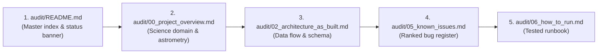

# AstroBlink — Agent Onboarding & Operational Manual

**Purpose:** Operational orientation and execution guide written specifically for the next autonomous AI agent or software engineer taking over the AstroBlink repository with zero prior context.  
**Last-Verified Date:** `2026-10-13`  
**Audited Commit:** `cc39991`  

---

## 1. Ten-Minute Rapid Orientation

Welcome to AstroBlink. This repository is a citizen-science blink comparator for the NASA SPHEREx space telescope ("Planet X and SPHEREx", NASA Space Apps Challenge 2026).

Before executing commands or editing code, read the repository in this strict sequential order:



### Essential Mental Model
1. **The Ingestion Pipeline Works:** The worker (`worker/`) successfully queries NASA IRSA TAP, downloads raw multi-band Level 2 FITS via S3 HTTP ranged byte requests, co-adds narrow wavelength slices ($1.0, 2.0, 4.0\text{ }\mu\text{m}$), generates $293 \times 293$ PNG tiles, and stores them in MinIO/S3.
2. **The API & Consensus Algorithm Work:** The backend (`api/`) serves subjects, receives volunteer classifications, clusters marks with haversine DBSCAN, computes volunteer reliability weights, and exports candidates in CSV and IVOA VOTable 1.4 XML.
3. **The Client is an Obsolete Scaffold:** The Next.js frontend (`client/`) still uses retired band keys (`swir`, `mwir`) and hardcodes an incorrect $128 \times 128$ linear coordinate deprojection. It must be rebuilt to match the $293 \times 293$ narrow-slice tiles and WCS tangent projection.
4. **Contracts are the Authority:** `contracts/openapi.yaml` and `contracts/schemas/` govern all inter-service communication. All inter-service communication occurs strictly over HTTP, PostgreSQL, Redis, and S3/MinIO. There is **zero shared code** between services.

---

## 2. Operating Environment & Command Safety Rules

### Host Environment Constraints [VERIFIED]
- **Operating System:** Windows 10/11 running PowerShell.
- **`make` is NOT installed.** Never attempt to run `make`, `make build`, or `make test`.
- **Always specify project name and project directory:**
  ```powershell
  # CORRECT:
  docker compose -f infra/docker-compose.yml -f infra/docker-compose.override.yml --project-directory . -p astroblink <subcommand>
  ```
- **Always pass `-f infra/docker-compose.override.yml` explicitly:**  
  When running `docker compose` with `-f infra/docker-compose.yml`, Docker does **NOT** automatically merge `docker-compose.override.yml`. You must provide both `-f` flags to ensure bind-mounts for `/build/scripts` and `/contracts` are present.

### Strictly Forbidden Commands [CAUTION]
1. **NO destructive Docker operations:**
   - `docker system prune` (Strictly Forbidden — deletes other workspaces).
   - `docker volume prune` (Strictly Forbidden — destroys persistent database and MinIO volumes).
   - `docker compose down -v` (Strictly Forbidden on `astroblink`, `ab-worker`, or `ab-api`; permitted **only** on throwaway test projects like `ab-audit`).
2. **NO destructive Git operations:**
   - `git reset --hard` (Strictly Forbidden).
   - `git clean -fdx` (Strictly Forbidden — deletes local `.env` and worktrees).
   - `git push --force` (Strictly Forbidden).
3. **NO interactive editors without flags:**
   - Do not run `git merge` without `--no-edit`, or PowerShell will hang waiting for Vim/Nano input.

### Worktrees & Port Isolation Matrix [VERIFIED]
The repository uses parallel Git worktrees. Do **not** mix ports or compose project names:

| Context | Worktree Directory | Git Branch | Compose Project | Postgres | Redis | API | Client | MinIO Console |
| :--- | :--- | :--- | :--- | :---: | :---: | :---: | :---: | :---: |
| **Main** | `D:\GITHUB\ME\AstroBlink` | `main` | `astroblink` | 5432 | 6379 | 8000 | 3000 | 9001 |
| **Worker** | `D:\GITHUB\ME\astroblink-worker` | `feat/worker-ingestion` | `ab-worker` | 5433 | 6380 | 8001 | 3001 | 9101 |
| **API** | `D:\GITHUB\ME\astroblink-api` | `feat/api-consensus` | `ab-api` | 5434 | 6381 | 8002 | 3002 | 9201 |
| **Audit/Test** | Throwaway temporary | Any | `ab-audit` | 5440 | 6390 | 8010 | 3010 | 9301 |

---

## 3. Sources of Truth vs Outdated Documents

When you encounter conflicting information between documents and code, apply this hierarchy of authority:

| Priority | Category | Authoritative Files | Notes |
| :---: | :--- | :--- | :--- |
| **1** | **Physical Ground Truth** | Running Docker containers, database tables, S3 objects | Evidence beats documentation every time. |
| **2** | **Astrometric Science Rules** | `docs/VERIFIED_FACTS.md`, `audit/00_project_overview.md` | Contains validated JPL Horizons orbital calculations, wavelength boundaries, and SPHEREx camera geometry. |
| **3** | **API Contracts** | `contracts/openapi.yaml`, `contracts/schemas/` | Defines HTTP schemas and wire contracts. (Note: schemas currently require ISS-04 update). |
| **4** | **Database Schema** | `api/alembic/versions/` (migration 001) | Reflects actual PostgreSQL tables and columns. |
| **5** | **Architecture Reality** | `audit/02_architecture_as_built.md`, `audit/03_component_audit.md` | As-built technical architecture. |
| **6** | **Historical Planning** | `docs/PRD.md`, `docs/ARCHITECTURE.md`, `docs/ROADMAP.md` | **Outdated in places** (e.g. references to `backend/`, `frontend/`, `swir`/`mwir` bands). Use `audit/04_plan_vs_reality.md` to see deviations. |

---

## 4. How to Test Changes Safely

Always test changes inside Docker containers before committing:

### 1. Run API Tests [VERIFIED]
```powershell
docker compose -f infra/docker-compose.yml -f infra/docker-compose.override.yml --project-directory . -p astroblink run --rm api pytest -v --ignore=tests/test_contract_validation.py
```
> [!NOTE]
> `test_contract_validation.py` currently requires `--ignore` until `jsonschema` is added to `api/requirements-dev.txt` [ISS-05]. Once ISS-05 is resolved, run plain `pytest -v`.

### 2. Run Worker Tests [VERIFIED]
```powershell
docker compose -f infra/docker-compose.yml -f infra/docker-compose.override.yml --project-directory . -p astroblink run --rm worker pytest -v
```
> [!IMPORTANT]
> The worker test suite requires `/contracts` mounted into the container via `infra/docker-compose.override.yml`. Ensure `-f infra/docker-compose.override.yml` is passed.

### 3. Run Client Tests [VERIFIED]
```powershell
docker compose -f infra/docker-compose.yml -f infra/docker-compose.override.yml --project-directory . -p astroblink run --rm client npm test
```

### 4. Enqueue a Test Ingestion Job Safely [VERIFIED]
Do **not** use `redis-cli lpush` directly from PowerShell; PowerShell strips inner double quotes, corrupting the JSON payload. Instead, execute the enqueue script via Python inside the container:

```powershell
docker compose -f infra/docker-compose.yml -f infra/docker-compose.override.yml --project-directory . -p astroblink exec api python -c "
import redis, json
r = redis.Redis(host='redis', port=6379, db=0)
job = {
    'job_id': 'test-job-001',
    'ra_deg': 269.45407,
    'dec_deg': 66.05342,
    'size_deg': 0.5,
    'target_id': 'test_target',
    'epoch1_date_range': ['2025-04-01', '2025-05-01'],
    'epoch2_date_range': ['2025-10-01', '2025-11-01']
}
r.lpush('astroblink:ingest_jobs', json.dumps(job))
print('Job enqueued successfully')
"
```

---

## 5. Top 7 Traps to Avoid

1. **PowerShell `Invoke-WebRequest` Hangs:**  
   In Windows PowerShell 5.1, `Invoke-WebRequest` attempts to parse DOM with Internet Explorer and hangs. Always pass `-UseBasicParsing` or use `curl.exe` / `Invoke-RestMethod`.
2. **Missing `override.yml` in Docker Commands:**  
   If you omit `-f infra/docker-compose.override.yml`, `/build/scripts` and `/contracts` are not mounted, causing database migration scripts and worker contract tests to crash.
3. **Container Exit Code 137 (OOM):**  
   Docker memory limit reached. Check `C:\Users\<USER>\.wslconfig` and ensure WSL2 memory is allocated at least `8GB` (preferably `12GB`).
4. **Windows Excluded Port Ranges:**  
   If Docker fails with `bind: An attempt was made to access a socket in a way forbidden by its access permissions`, Windows Hyper-V dynamic port reservation has grabbed the port. Run `netsh interface ipv4 show excludedportrange protocol=tcp` and select an open port.
5. **Slow AWS S3 Ingestion Timeout:**  
   If `worker` throws `TimeoutError: Ingestion job exceeded 600s timeout`, your network connection to AWS `us-east-1` is saturated or under 100 KB/s. Set `JOB_TIMEOUT_SEC=1200` in `.env`.
6. **Hardcoded Band Keys in Client:**  
   Do not look for `swir` or `mwir`. The worker produces `1_1.0um`, `1_2.0um`, `1_4.0um`, and `1_rgb`.
7. **Cross-Folder Code Sharing:**  
   Never import code from `api/` into `worker/` or vice versa. They run in separate containers and build independently. Share data only via REST endpoints, Redis payloads, and PostgreSQL schemas.

---

## 6. User Workflow Expectations

To maintain high engineering quality and prevent agent hallucinations, adhere strictly to these operational guidelines:
- **One Phase Per Turn:** Complete one defined phase per turn, summarize files written and any unverified items, and await user approval before proceeding.
- **Evidence or It Didn't Happen:** Label every factual claim `[VERIFIED]`, `[REPORTED]`, or `[UNVERIFIED/UNKNOWN]`. Cite exact file paths, line ranges, and real terminal output.
- **Do Not Change Existing Code Without Explicit Instruction:** During audits and documentation phases, never alter production code or configs. Record issues in `audit/05_known_issues.md`.

---

## 7. Ready-to-Use Prompt Templates

Copy-paste these exact prompts when initiating follow-up work:

### Template 1: Rebuild Frontend Client
```text
Task: Rebuild the AstroBlink Next.js client to match current API contracts and narrow-slice tiles.

Context: Read audit/README.md, audit/02_architecture_as_built.md, and audit/05_known_issues.md (specifically ISS-02, ISS-04, ISS-12).
Environment: Windows PowerShell, Docker project 'astroblink'.

Goals:
1. Update TypeScript API client types from contracts/openapi.yaml.
2. Refactor BandSelector.tsx to dynamically render narrow-slice bands (1.0 μm, 2.0 μm, 4.0 μm, RGB composite).
3. Rebuild the Canvas/Blink comparator in client/src/app/classify/page.tsx to render 293x293 tiles and compute celestial coordinates (RA, Dec) using the WCS tangent projection matrix from the .wcs.json sidecar.
4. Align the classification submission payload with contracts/schemas/classification.yaml.
5. Verify client build and run tests: docker compose -f infra/docker-compose.yml -f infra/docker-compose.override.yml --project-directory . -p astroblink run --rm client npm test
```

### Template 2: Batch Ingest Real SPHEREx Target Fields
```text
Task: Ingest 5 astronomical SPHEREx sky cells across verified target coordinates.

Context: Read audit/03_component_audit.md (§Worker Pipeline) and audit/06_how_to_run.md (§7 Ingestion Verification).
Environment: Windows PowerShell, Docker project 'astroblink'.

Goals:
1. Verify worker container is running with active profile: docker compose -f infra/docker-compose.yml -f infra/docker-compose.override.yml --project-directory . -p astroblink ps
2. Using the coordinates for Targets 1 through 5 from docs/VERIFIED_FACTS.md §7A, enqueue 5 ingestion jobs to Redis 'astroblink:ingest_jobs'.
3. Monitor worker container logs until all 5 targets complete co-addition and tile upload to MinIO.
4. Query the API subjects endpoint (GET /api/v1/subjects) to verify all 5 subjects are active with full tile sets.
5. Report total ingestion runtime, bytes downloaded, and tile keys generated.
```

### Template 3: Deploy to Cloud Provider (Fly.io / Render)
```text
Task: Prepare AstroBlink infrastructure and Dockerfiles for production cloud deployment.

Context: Read audit/02_architecture_as_built.md, audit/05_known_issues.md (ISS-01, ISS-09), and audit/09_next_steps.md (§Phase 4).
Environment: Multi-stage Docker builds.

Goals:
1. Enforce strict production check on ADMIN_TOKEN in api/app/config.py (refuse startup if default token is active in production).
2. Configure CORS origins in api/app/config.py to accept configurable FRONTEND_URL.
3. Optimize api/Dockerfile, worker/Dockerfile, and client/Dockerfile using multi-stage builds and non-root service users.
4. Create production deployment manifests (e.g. fly.toml or docker-compose.prod.yml) specifying managed PostgreSQL, Redis, and S3-compatible storage.
5. Verify container builds locally and test cold startup with production environment flags.
```
